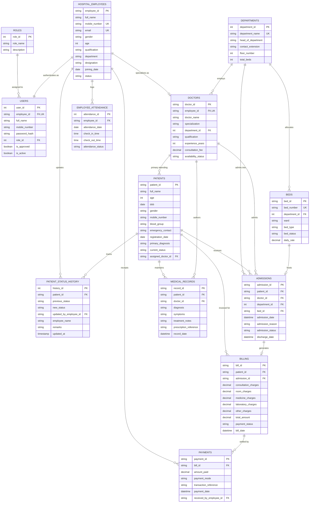

# Entity Relationship (ER) Diagram & Relational Schema Specification
## Hospital Patient Data Analysis and Management System
**Mohan Babu University (MBU) - B.Tech CS-IT Project**

### 1. Conceptual and Logical Database Architecture
The database follows Boyce-Codd Normal Form (BCNF) / 3NF to eliminate redundancy, avoid update anomalies, and enforce clinical referential integrity.

### 2. Entity Constraints and Cardinalities
- **Role to User**: 1-to-Many (`Roles.role_id` $\rightarrow$ `Users.role_id`).
- **Employee to User**: 1-to-1 (`Hospital_Employees.employee_id` $\rightarrow$ `Users.employee_id`).
- **Employee to Doctor**: 1-to-1 (`Hospital_Employees.employee_id` $\rightarrow$ `Doctors.employee_id`).
- **Patient to Status History**: 1-to-Many (`Patients.patient_id` $\rightarrow$ `Patient_Status_History.patient_id`).
- **Patient to Admissions**: 1-to-Many (`Patients.patient_id` $\rightarrow$ `Admissions.patient_id`).
- **Department to Beds**: 1-to-Many (`Departments.department_id` $\rightarrow$ `Beds.department_id`).
- **Admission to Bed**: 1-to-1 optional relationship for in-patient bed allocation.
- **Billing to Payments**: 1-to-Many (`Billing.bill_id` $\rightarrow$ `Payments.bill_id`).
